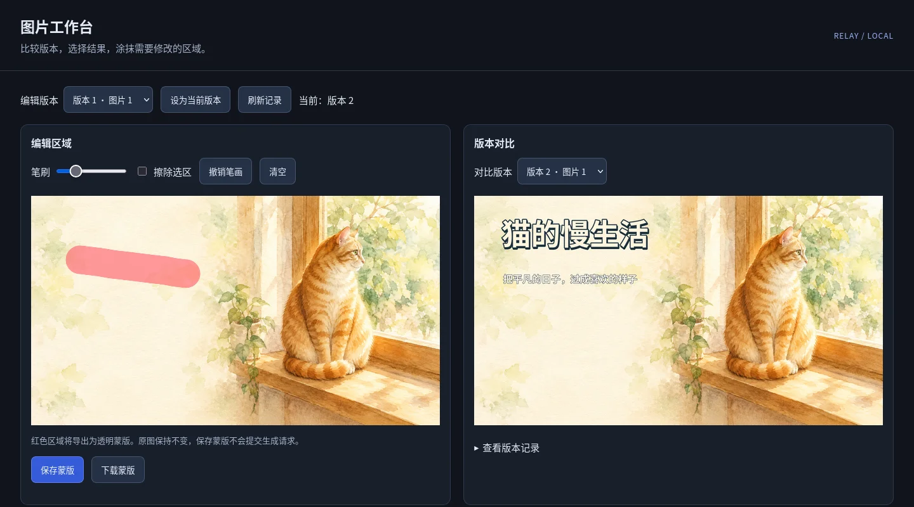

# Relay ImageGen

**用你自己的图片 API，在对话中生成图片、修改素材、制作中文封面。**

Relay ImageGen 是一套可安装到 Codex 的生图技能，也可以直接在终端使用。配置中转站地址、API Key 和模型后，你只需描述想要的画面；图片会保存到本地，方便继续修改、比较版本和导出。



## 可以做什么

| 功能 | 用法举例 |
| --- | --- |
| 文生图 | “生成一张雨夜城市海报，蓝紫色调，不要文字。” |
| 多图与不同方案 | “生成三张水彩插画，分别画橘猫、雪山和海边。” |
| 参考图编辑 | “使用这张产品图，换成暖色摄影棚背景。” |
| 局部编辑 | 在浏览器里涂抹选区，再描述要改变的内容。 |
| 中文封面 | 将生成的背景与准确标题、本地字体、logo 等素材组合。 |
| 版本管理 | 选择某张结果继续修改，或回到父版本；旧图不会被覆盖。 |
| 多尺寸导出 | 将同一封面配方导出为不同尺寸的 PNG、JPEG 或 WebP。 |
| 流式预览 | 接口支持时，在最终图片完成前保存中间预览。 |

支持查询中转站模型、配置模型能力，以及按需使用 Responses 图像工具。具体功能取决于你的服务商和模型；项目不会根据模型名字推断实际能力，也不保证与官方产品的效果相同。

## 使用前准备

- **Python 3.9 或更新版本**。
- 一个支持图片生成或编辑的 **OpenAI 兼容 API 地址、API Key 和准确模型 ID**。没有 API 配置也可以使用本地封面排版和图片工作台。
- 使用蒙版、封面排版或工作台时安装 **Pillow**；中文封面还需要包含相应字形的字体，例如 Noto Sans CJK。
- 想在对话中调用时，使用能加载本地技能并执行 Python 的 Codex 环境。

本项目是第三方工具，不是 OpenAI 官方产品。生图和模型编辑由所配置的服务商提供，可能产生费用；本地排版、比较版本和绘制蒙版不会调用生图接口。

## 安装与配置

### 1. 下载并安装

下载本仓库 ZIP 并解压，在项目目录打开终端。下面示例使用 `python3`；Windows 中可以按安装情况替换为 `py -3` 或 `python`。

```bash
python3 -m pip install -r requirements.txt
python3 tools/install.py
```

安装器默认将技能放到 `~/.agents/skills/relay-imagegen`。在 Codex 中开启新会话后，使用 `$relay-imagegen` 调用。安装器不修改 API 配置，遇到已有安装时不会直接覆盖。

如果只需要终端命令，可以不安装技能，直接在项目目录运行下文示例。若使用虚拟环境，需让 Codex 调用同一个已安装 Pillow 的 Python 环境。

### 2. 填写中转站配置

在你自己的交互式终端运行：

```bash
python3 skills/relay-imagegen/scripts/relay_imagegen.py config setup
```

依次填写：

| 配置项 | 填写内容 |
| --- | --- |
| Base URL | 服务商提供的 API 地址，例如 `https://relay.example.com` 或带 `/v1` 的前缀。 |
| 模型 | 服务商提供的准确模型 ID；不要把预填名称当作可用模型。 |
| API Key | 服务商生成的密钥，输入时不会显示。 |

不要把 Key 贴到聊天、命令参数或截图里。默认配置保存在 `~/.codex/relay-imagegen.json`，与安装目录分开；设置了 `CODEX_HOME` 时使用该目录下的配置文件。

### 3. 查看状态

```bash
python3 skills/relay-imagegen/scripts/relay_imagegen.py config status
```

`ready: true` 表示必要字段已填写，不代表接口已经连通。查看服务商公开的模型列表可以运行：

```bash
python3 skills/relay-imagegen/scripts/relay_imagegen.py models
```

更多配置方式、环境变量和常见错误见 [配置与排错](skills/relay-imagegen/references/configuration.md)。

## 在 Codex 对话中使用

安装并配置后，可以直接发送：

> 使用 $relay-imagegen，生成一张窗边橘猫的水彩插画，左侧留白，不要文字。

> 使用 $relay-imagegen，把这张素材做成三款视频封面，标题是“我的周末计划”，分别给我三张独立图片。

> 使用 $relay-imagegen，继续修改第二张，保持主体和画风，把背景换成夜景。

有素材时提供图片或本地文件路径；有准确标题时给出完整原文。需要保留编辑历史时，补充“保存到同一个版本会话，方便继续修改”。结果会保存到本地，并给出文件路径；能否直接在对话内预览，取决于客户端。

如果没有发现技能，先开启新会话，再确认安装器显示的目录中包含 `SKILL.md`。

## 在终端生成和编辑

以下命令都从项目根目录执行。生图和模型编辑会提交真实请求。

**生成一张图，并建立版本会话：**

```bash
python3 skills/relay-imagegen/scripts/relay_imagegen.py generate \
  --prompt-file examples/prompt.txt \
  --session output/my-project/session.json \
  --output-dir output/my-project
```

同一提示词要多张结果，加 `--n 3`。如果服务商明确只支持单张请求，显式加 `--request-mode separate`。

**不同提示词分别生成：**

```bash
python3 skills/relay-imagegen/scripts/relay_imagegen.py generate \
  --prompts-file examples/prompts.json \
  --output-dir output/variants
```

**用自己的素材进行编辑：**

```bash
python3 skills/relay-imagegen/scripts/relay_imagegen.py edit \
  --image /path/to/your-image.png \
  --prompt "保留主体，将背景换成温暖的摄影棚" \
  --session output/my-project/session.json \
  --output-dir output/my-project
```

将 `/path/to/your-image.png` 换成真实文件路径。可重复 `--image` 传入多张参考图，并在提示词中说明每张的用途。

成功后查看 `files` 中的图片路径。失败时也可能有已保存图片，应先查看结果；程序不会自动重试或补足图片数量。

## 局部编辑：涂抹后再描述

1. 用上面的命令生成图片并保存会话；已有运行记录也可以 [导入版本历史](skills/relay-imagegen/references/advanced.md#本地版本会话)。
2. 启动本地工作台：

   ```bash
   python3 skills/relay-imagegen/scripts/relay_imagegen.py studio \
     --session output/my-project/session.json
   ```

3. 将终端输出的完整 `studio_url` 复制到本机浏览器。保持终端运行。
4. 左侧选择图片，用画笔涂抹要修改的区域。可擦除、撤销或清空。
5. 点击 **保存蒙版**，记下页面给出的原运行记录、图片编号和蒙版路径。
6. 回到 Codex，说出修改要求并提供这些路径；或者在终端执行：

   ```bash
   python3 skills/relay-imagegen/scripts/relay_imagegen.py edit \
     --from-run /path/to/run-record.json \
     --image-index 1 \
     --mask /path/to/saved-mask.png \
     --prompt-file examples/edit.txt \
     --session output/my-project/session.json \
     --output-dir output/my-project
   ```

将路径和编号替换为页面给出的值。编辑成功后，点工作台的 **刷新记录** 比较新旧版本。

**画笔在浏览器里，不在 CLI 终端里。** 保存蒙版只保存选区，不提交生图请求。红色选区导出为透明区域，表示允许模型修改；区域外仍需检查是否发生变化。工作台只允许本机访问，使用完按 `Ctrl+C` 关闭。

## 不调用 API，先做一张中文封面

仓库附带了示例背景和配方，安装 Pillow 后即可运行：

```bash
python3 skills/relay-imagegen/scripts/relay_imagegen.py cover \
  --spec examples/cover.json \
  --output-dir output/cover-demo
```


修改 `examples/cover.json` 中的标题、颜色、位置和尺寸即可重新排版。若提示找不到中文字体，在配方顶层添加 `"font": "/path/to/your-cjk-font.ttf"`，使用本机实际字体路径；Windows JSON 路径可写成 `C:/Windows/Fonts/字体文件名.ttf`。

这个步骤使用附带背景进行本地排版，不生成新背景，也不产生 API 费用。详细配方见 [封面排版说明](skills/relay-imagegen/references/covers.md)。

## 更多用法

- [配置与排错](skills/relay-imagegen/references/configuration.md)：接口地址、模型查询、配置覆盖和常见报错。
- [高级功能](skills/relay-imagegen/references/advanced.md)：版本切换与回退、能力配置、压缩率、流式预览、Responses。
- [视频封面](skills/relay-imagegen/references/video-covers.md)：素材、标题、布局与后续修改。
- [封面配方](skills/relay-imagegen/references/covers.md)：字体、描边、阴影、图片图层和多尺寸导出。

## 常见问题

**图片保存在哪里？**

默认在运行命令时所在目录的 `output/relay-imagegen`；也可以用 `--output-dir` 指定。新图片不会覆盖旧图片。

**提示模型或参数不支持怎么办？**

先查服务商文档或联系服务商。模型列表只说明名称，不能证明支持编辑、蒙版、透明背景、流式或 Responses；不要反复付费调用来猜测。

**生成尺寸和要求不一样怎么办？**

工具会保留原图并提示实际尺寸。封面命令可以本地裁切和导出指定尺寸，这不代表接口原生输出了该尺寸。

**只改标题需要再生图吗？**

使用封面配方排版时不需要。修改配方后重新运行 `cover` 即可复用原背景。

**能在 ChatGPT Desktop 中直接使用吗？**

需要客户端能加载这份技能、执行本地 Python 并访问图片文件；仅上传一个 ZIP 不等于这些条件已经具备。如果当前环境不能执行脚本，可以使用本项目的终端命令和浏览器工作台。

**怎么更新已安装的技能？**

下载新版仓库，在新项目目录运行 `python3 tools/install.py --replace`。旧版会备份到安装目录上级的 `skill-backups`，API 配置不变。如果之前安装到其他位置，使用 `--destination` 指定那个完整技能目录；如果旧目录本来就是指向当前项目的链接，项目更新后会直接生效。
